# Configure generated CRUD routes

Part of [DKNet.AspCore.Extensions](index.md). `CrudMapOptions` configures the endpoints emitted by `DKNet.SlimBus.Generators`. You pass it through a generated `Map{Entity}Crud` callback. This standalone example exercises its guards without generated types:

```csharp
using DKNet.AspCore.Extensions.Endpoints;
var options = new CrudMapOptions().Exclude(CrudOp.Delete).Exclude("UpdateName");
options.ValidateRouteNames("Product", "GetById", "GetList", "Create", "Delete", "UpdateName");
Console.WriteLine(options.IsExcluded(CrudOp.Delete)); // True
Console.WriteLine(options.IsExcluded("UpdateName")); // True
```

None — no DI registration needed; `CrudMapOptions` is a plain options object you construct and configure directly, as above.



`CrudOp` values are `GetById`, `GetList`, `Create`, `Update`, `Delete`, `Action`. `Exclude(params CrudOp[])` removes an entire operation kind; `Exclude(params string[])` removes named routes. `Configure(CrudOp, Action<RouteHandlerBuilder>)` attaches settings to each route of a kind; the string overload targets one name. Both are additive and chainable. Nothing is excluded or customized initially.

The generator checks operation and name exclusions, validates names before mapping, and calls `Apply` with kind and name. `Apply` runs operation settings first and name settings second, each in registration order. Names are ordinal and case-sensitive: fixed operation names plus each marked update/action method’s C# name, not its kebab-case URL segment. Unknown configured/excluded names throw `ArgumentException` from `ValidateRouteNames`.

The generator owns route production and the `[CrudCreate]`, `[CrudUpdate]` and `[CrudAction]` conventions. Read [generator naming and routing](../DKNet.SlimBus.Generators/name-requests-and-routes.md) for those rules.

## ⚙️ Configuration reference

| `CrudOp` value | Meaning |
|---|---|
| `GetById` | The GET-by-id endpoint. |
| `GetList` | The paged GET-list endpoint. |
| `Create` | The POST create endpoint. |
| `Update` | The PUT update endpoint(s). |
| `Delete` | The DELETE-by-id endpoint. |
| `Action` | The generated domain-action endpoint(s). |

| `CrudMapOptions` member | Default | Effect |
|---|---|---|
| `Exclude(params CrudOp[])` | nothing excluded | Removes every route of the given operation kind(s). |
| `Exclude(params string[])` | nothing excluded | Removes the one route carrying each given member name. |
| `Configure(CrudOp, Action<RouteHandlerBuilder>)` | none registered | Runs for every route of that operation kind, in call order, before name settings. |
| `Configure(string, Action<RouteHandlerBuilder>)` | none registered | Runs for the one route carrying that name, after operation-kind settings. |

There is no interface to implement here: `CrudMapOptions` is a plain options object the generated `Map{Entity}Crud(Action<CrudMapOptions>? configure = null)` passes to your `configure` callback.

## 🧱 Where it fits

| DKNet consumer | Package | What it does with this feature |
|---|---|---|
| `Map{Entity}Crud` (generated) | [SlimBus Generators](../DKNet.SlimBus.Generators/map-crud-endpoints.md) | Constructs `CrudMapOptions`, invokes your `configure` callback, then calls `ValidateRouteNames`, `IsExcluded` and `Apply` with each `CrudOp` before mapping a route. |

**Entry point in your app:** the `configure` callback you pass to a generated `Map{Entity}Crud(...)` call in `Program.cs` — see [Map CRUD endpoints](../DKNet.SlimBus.Generators/map-crud-endpoints.md).

## ⚠️ Gotchas & limits

- Excluding one named update does not move another update to a new URL.
- Configuring a route whose kind is excluded still validates its name, then has no route to apply to.
- `ValidateRouteNames` and `Apply` are public support methods for generated code; declaring options alone maps nothing.
- This package does not run the source generator or supply business handlers. Install/configure the generator separately.
