# Resolve the current principal for sensitive-data serialization

Part of [DKNet.AspCore.Extensions](index.md). `AddSensitiveDataPrincipalAccessor` connects the EF Core sensitive-data serialization contract to the current HTTP user:

```csharp
using DKNet.AspCore.Extensions.Security;
using DKNet.EfCore.Extensions.Serialization;
using Microsoft.Extensions.DependencyInjection;
var services = new ServiceCollection();
services.AddSensitiveDataPrincipalAccessor();
using var provider = services.BuildServiceProvider();
Console.WriteLine(provider.GetRequiredService<ISensitiveDataPrincipalAccessor>().Current is null); // True
```



The helper adds `IHttpContextAccessor` and tries to register the internal singleton `HttpContextSensitiveDataPrincipalAccessor` for `ISensitiveDataPrincipalAccessor`. Its `Current` reads `HttpContext.User` on access; outside a request it returns null. An existing contract registration is retained.

## ⚙️ Configuration reference

`AddSensitiveDataPrincipalAccessor()` reads no options.

| Override point | How you customise it |
|---|---|
| `ISensitiveDataPrincipalAccessor` | Declared in [EF Core Extensions](../DKNet.EfCore.Extensions/filter-sensitive-responses.md). Register your own implementation with `services.AddSingleton<ISensitiveDataPrincipalAccessor, TYourAccessor>()` before calling `AddSensitiveDataPrincipalAccessor()` — the helper uses `TryAddSingleton`, so an earlier registration wins. |

## 🧱 Where it fits

| DKNet consumer | Package | What it does with this feature |
|---|---|---|
| `UseRoleAwareSensitiveData` (`SensitiveDataJsonExtensions`) | [Withhold sensitive properties from unauthorised callers](../DKNet.EfCore.Extensions/filter-sensitive-responses.md) | Resolves `ISensitiveDataPrincipalAccessor.Current` to decide whether the current caller's `JsonSerializerOptions` should expose or redact a `[SensitiveData]`-marked member. |

**Entry point in your app:** `builder.Services.AddSensitiveDataPrincipalAccessor()` in `Program.cs`, then using `ISensitiveDataPrincipalAccessor` wherever your code configures `JsonSerializerOptions` for sensitive-data serialization.

## ⚠️ Gotchas & limits

- This registration neither authenticates a user nor configures sensitive-data serialization rules. It only supplies the principal bridge.
- An existing custom `ISensitiveDataPrincipalAccessor` takes precedence because registration uses `TryAddSingleton`.
- Do not assume an HTTP principal exists in startup jobs or other work outside the request context.
