# Select a named job from command-line arguments

Part of [DKNet.AspCore.Extensions](index.md). `JobSelector.Select` finds the first argument that is not an option and matches it against a caller-supplied set of job names:

```csharp
using DKNet.AspCore.Extensions.Jobs;
var selection = JobSelector.Select(["--environment", "Development", "SEED"], ["seed", "warm"]);
Console.WriteLine(selection.JobName); // seed
Console.WriteLine(selection.IsRecognized); // True
```



Arguments starting with `-` are skipped. An option without `=` also consumes the following argument; an inline option such as `--environment=Development` consumes only itself. Matching is case-insensitive and preserves the canonical known name.

`JobSelection` carries `RequestedJobName`, nullable canonical `JobName`, `IsRecognized`, and a copied `KnownJobNames` list. `HasJobName` means a candidate was found, even if unknown. No candidate produces null names and false recognition; an unknown candidate preserves the requested string but no canonical name.

None — no DI registration needed; `JobSelector.Select` is a static method you call directly.

## ⚙️ Configuration reference

None — `JobSelector.Select` reads no options and exposes no override point. Pass your own known-job-name list as an argument on each call.

## 🧱 Where it fits

None — no other DKNet package calls `JobSelector.Select`; you call it from your own startup/console code.

**Entry point in your app:** calling `JobSelector.Select(args, knownJobNames)` early in your host's startup, typically before `WebApplication.CreateBuilder`/`Host.CreateApplicationBuilder` runs the rest of its pipeline.

## ⚠️ Gotchas & limits

- This helper selects only; it does not register, run or schedule a job and does not stop the host.
- Every dash-prefixed option without `=` consumes a following argument, including flags that an application might consider valueless. Choose argument conventions accordingly.
- Null argument/name collections throw. Known-name ordering decides the first case-insensitive match.
