# Reserve Redis keys and retain response values

Part of [DKNet.AspCore.Idempotency.RedisStore](index.md). After provider registration, the filter uses the public core contract. This sample registers the store, then constructs the identity you would pass to that contract:

```csharp
using DKNet.AspCore.Idempotency.Filtering;
using DKNet.AspCore.Idempotency.RedisStore;
using Microsoft.Extensions.DependencyInjection;

var services = new ServiceCollection();
services.AddLogging();
services.AddIdempotencyWithRedisStore("localhost:6379");

var key = new IdempotentKeyInfo
{
    Scope = "user:demo", Method = "POST", Endpoint = "/ORDERS", IdempotentKey = "order-1"
};
Console.WriteLine(key.CompositeKey); // user:demo:POST:/ORDERS:order-1
```


The Redis key is `CachePrefix` followed directly by the lowercase SHA-256 hex digest of this identity. `IsKeyProcessedAsync` calls `StringSetAndGetAsync` with `When.NotExists`, reservation JSON and the reservation TTL. That is one atomic set-if-absent-and-return-previous operation, not GET followed by SET.

No previous value means this call reserved the key. A returned 102 sentinel means a duplicate still in flight; a completed record supplies the replay data. A logically expired record is deleted and the method recursively retries reservation. Invalid JSON propagates as a lookup error. Completion serializes `CachedResponse` and overwrites the key with `StringSetAsync` and the completed TTL.

## ⚙️ Configuration reference

The store reuses core options; the linked pages own their types and defaults.

| Core setting | Redis use |
|---|---|
| [`CachePrefix`](../DKNet.AspCore.Idempotency/choose-store.md#-configuration-reference) | Prefix before the lowercase SHA-256 digest. |
| [`InFlightReservationTimeout`](../DKNet.AspCore.Idempotency/replay-responses.md#-configuration-reference) | TTL of the status-102 reservation. |
| [`Expiration`](../DKNet.AspCore.Idempotency/replay-responses.md#-configuration-reference) | TTL of the completed record. |
| [`JsonSerializerOptions`](../DKNet.AspCore.Idempotency/replay-responses.md#-configuration-reference) | Serialization of the stored record. |

## 🧱 Where it fits

| DKNet consumer | Package | What it does with this feature |
|---|---|---|
| Endpoint filter (internal; contract documented in [Implement a custom reservation store](../DKNet.AspCore.Idempotency/implement-store.md)) | DKNet.AspCore.Idempotency | Resolves this store as `IIdempotencyKeyStore` and calls `IsKeyProcessedAsync` then `MarkKeyAsProcessedAsync` around each protected handler. |



**Entry point in your app:** register this provider via `AddIdempotencyWithRedisStore` in `Program.cs`, then protect an endpoint with `.RequiredIdempotentKey()`; the filter then uses the store transparently.

## ⚠️ Gotchas & limits

- No table migrations or cleanup job exist. Redis TTL controls physical key expiry; logical `ExpiresAt` is checked as well.
- Changing the prefix creates another key namespace; it does not rename existing entries.
- Logical-expiry cleanup uses an unconditional delete before retry. Do not assume a compare-and-delete ownership protocol.
- Completion has no reservation-owner token. A handler that outlives the TTL can overlap a later retry.
- Reservation or deserialization failures propagate. The core filter catches failures only on its completion path.
