# Understand schema and migrations

Part of [DKNet.AspCore.Idempotency.Relational](index.md). The provider's `IdempotencyDbContext` inherits the shared context, which discovers mappings in the derived context's assembly. The provider owns its migrations, SQL column types, and unique-violation classification.

```csharp
using DKNet.AspCore.Idempotency.MsSqlStore;
using Microsoft.Extensions.DependencyInjection;
var services = new ServiceCollection();
services.AddLogging();
services.AddIdempotencyMsSqlStore("Server=localhost;Database=idempotency;Integrated Security=true;TrustServerCertificate=true");
```



This registers the provider context, factory and migration hosted service; use the `WithMsSqlStore` registration to select it as the key store as well. At host start, `IdempotencyMigrationHostedService<TContext>.StartAsync` applies pending migrations. Store operations also perform a defensive pending-migration check, remembered per connection string within each closed generic store type and guarded by a semaphore.

| Column or index | Shared mapping |
|---|---|
| `Id` | GUID primary key, created with `Guid.CreateVersion7()`. |
| `IdempotentKey` | Required non-Unicode string, maximum 500. |
| `Endpoint` / `Method` | Required strings, maximum 250 / 20; method non-Unicode. |
| `CompositeKey` | Required Unicode string, maximum 128; stores 64-character uppercase SHA-256 hex. |
| `StatusCode` | Required integer, provider check constraint `CK_StatusCode_Valid` for 100–599. |
| `Body` | Unicode, configured maximum 1,048,576; SQL column type comes from the provider. |
| `ContentType` | Nullable non-Unicode string, maximum 256. |
| `CreatedAt` / `ExpiresAt` | Timestamp / nullable timestamp. |
| `UX_CompositeKey` | Unique composite-hash lookup index. |
| Expiry index | EF index on `ExpiresAt` for queries and external cleanup. |

Only the lookup identity is hashed. The raw client key, route template and method are retained as columns.

## ⚙️ Configuration reference

None — the shared schema and its migration-ownership rule are fixed mapping; this page exposes no option or override point. The per-provider design-time connection variables (`IDEMPOTENCY_MSSQL_CONNECTION`, `IDEMPOTENCY_NPGSQL_CONNECTION`) belong to [MsSqlStore](../DKNet.AspCore.Idempotency.MsSqlStore/persist-responses.md) and [NpgsqlStore](../DKNet.AspCore.Idempotency.NpgsqlStore/persist-responses.md).

## 🧱 Where it fits

| DKNet consumer | Package | What it does with this feature |
|---|---|---|
| MsSqlStore's `IdempotencyDbContext` | [MsSqlStore](../DKNet.AspCore.Idempotency.MsSqlStore/persist-responses.md) | Extends the shared context; EF Core discovers `IdempotencyKeyConfiguration` from its own assembly to map this schema onto SQL Server. |
| NpgsqlStore's `IdempotencyDbContext` | [NpgsqlStore](../DKNet.AspCore.Idempotency.NpgsqlStore/persist-responses.md) | Same, for PostgreSQL. |



**Entry point in your app:** you never query this schema directly — it exists once you register a provider (`AddIdempotencyMsSqlStore`/`AddIdempotencyNpgsqlStore`) in `Program.cs`.

## ⚠️ Gotchas & limits

- The context and mapping are not public APIs. The friend-assembly list admits the in-repo providers and their tests only.
- Startup migration failures fail host startup. The account must have the permissions required by pending migrations.
- The fallback migration guard is in-process, not a deployment-wide migration coordinator.
- Declared maximum lengths describe EF mapping. Enforcement depends on the provider's actual column type and applied migrations.
- The shared entity does not expose a `Complete` method; the store completes rows through a direct update.
