# Declare audit capture and sensitive properties

Part of [DKNet.EfCore.Abstractions](index.md). Attach policy markers to the domain model and let the appropriate runtime consumer enforce them.

Use the console-project setup in the [Quick Start](index.md#-quick-start), then replace `Program.cs` with this example.

```csharp
using DKNet.EfCore.Abstractions.Attributes;

var property = typeof(Product).GetProperty(nameof(Product.Cost))!;
var rule = (SensitiveDataAttribute)Attribute.GetCustomAttribute(property, typeof(SensitiveDataAttribute))!;
Console.WriteLine(rule.Roles[0]); // pricing

public sealed class Product
{
    [SensitiveData("pricing")]
    public decimal Cost { get; set; }
}
```



`[AuditLog]` and `[IgnoreAuditLog]` target classes or properties; `[SensitiveData]` targets properties. These sealed attributes are non-inherited. They do not encrypt stored values.

None — no DI registration needed; `[AuditLog]`, `[IgnoreAuditLog]` and `[SensitiveData]` are declarative attributes read by AuditLogs, DtoGenerator and the opt-in JSON serializer.

## ⚙️ Configuration reference

| Marker | Default | Consumer effect |
|---|---|---|
| `[AuditLog]` | presence only | Entity opt-in under OnlyAttributedAuditedEntities; property plaintext/allow-list under the selected property policy. |
| `[IgnoreAuditLog]` | presence only | Exclude the entity or property from audit capture. |
| `[SensitiveData]` | empty `IReadOnlyList<string>` Roles | Any authenticated principal may receive the property after JSON opt-in. |
| `[SensitiveData("pricing", "audit")]` | supplied Roles | An authenticated principal needs at least one named role. |

A null role array is normalized to an empty list. Read [AuditLogs](../DKNet.EfCore.AuditLogs/index.md) for capture policies and [Encryption](../DKNet.EfCore.Encryption/index.md) for protection at rest.

## 🧱 Where it fits

| DKNet consumer | Package | What it does with this feature |
|---|---|---|
| `AuditLogExtensions` | [DKNet.EfCore.AuditLogs](../DKNet.EfCore.AuditLogs/redact-sensitive-values.md) | Reads `[AuditLog]`/`[IgnoreAuditLog]` to decide which entities and properties are captured, and unconditionally redacts `[SensitiveData]` values. |
| `SensitiveDataJsonExtensions` | [DKNet.EfCore.Extensions](../DKNet.EfCore.Extensions/filter-sensitive-responses.md) | Reads `[SensitiveData]` role names to withhold a property from a response after an explicit host opt-in, checking the current principal. |
| `DtoGenerator` / `AttributeSourceFormatter` | [DKNet.EfCore.DtoGenerator](../DKNet.EfCore.DtoGenerator/carry-property-attributes.md) | Copies a `[SensitiveData]` declaration onto the generated DTO property. |

AuditLogs and the opted-in JSON serializer read the same `[SensitiveData]` declaration independently: audit capture redacts unconditionally, while response serialization checks the host-supplied current principal.

**Entry point in your app:** put the attributes on your entity class/properties; register [AuditLogs](../DKNet.EfCore.AuditLogs/index.md) and/or the [response filter](../DKNet.EfCore.Extensions/filter-sensitive-responses.md) to act on them.


## ⚠️ Gotchas & limits

- AuditLogs first requires `IAuditedProperties`. Marking a plain entity `[AuditLog]` does not make it an audit candidate.
- `[IgnoreAuditLog]` excludes capture. `[SensitiveData]` redacts even alongside `[AuditLog]`; declared role names do not grant plaintext audit access.
- Responses require an explicit host [serialization opt-in](../DKNet.EfCore.Extensions/filter-sensitive-responses.md#withhold-sensitive-properties-from-unauthorised-callers). Request binding and other serializers are unaffected.
