# Expose an optimistic concurrency token

Part of [DKNet.EfCore.Abstractions](index.md). Implement `IConcurrencyEntity<TType>` to give infrastructure a consistent `RowVersion` property and setter.

Use the console-project setup in the [Quick Start](index.md#-quick-start), then replace `Program.cs` with this example.

```csharp
using DKNet.EfCore.Abstractions.Entities;

var account = new Account();
account.SetRowVersion([1, 2, 3]);
Console.WriteLine(account.RowVersion!.Length); // 3

public sealed class Account : Entity, IConcurrencyEntity<byte[]>
{
    public byte[]? RowVersion { get; private set; }
    public void SetRowVersion(byte[] version) => RowVersion = version;
}
```


The interface decorates `RowVersion` with `[Timestamp]`, `[Column(Order = 1000)]` and `[IgnoreAuditLog]`. The implementation owns storage; the interface has no setter implementation.

None — no DI registration needed; `IConcurrencyEntity<TType>` is an interface you implement on your entity.

## ⚙️ Configuration reference

| Override point | How you customise it |
|---|---|
| `IConcurrencyEntity<TType>` | Implement it on your entity; expose `RowVersion` and `SetRowVersion(TType)`. `TType` is whatever your storage uses (for example `byte[]` or `uint`). |

## 🧱 Where it fits

| DKNet consumer | Package | What it does with this feature |
|---|---|---|
| `DefaultEntityTypeConfiguration` | [DKNet.EfCore.Extensions](../DKNet.EfCore.Extensions/configure-model.md) | Recognizes `IConcurrencyEntity<TType>` while applying default entity configuration and configures a generated row-version concurrency token. |

**Entry point in your app:** implement `IConcurrencyEntity<TType>` on your entity; [DefaultEntityTypeConfiguration](../DKNet.EfCore.Extensions/configure-model.md) configures it when your `DbContext` builds its model through `UseAutoConfigModel`. Once EF Core detects a conflict, handle it with [Customise concurrency handling](../DKNet.EfCore.Extensions/customise-concurrency-handling.md).



## ⚠️ Gotchas & limits

- The contract alone does not perform a database conflict check. Configure the concrete property with EF Core.
- [Default entity conventions](../DKNet.EfCore.Extensions/configure-model.md) recognize the interface and configure a generated row-version concurrency token.
