# Declare events for persistence operations

Part of [DKNet.EfCore.Abstractions](index.md). Apply repeatable, non-inherited `[RaisesEvent]` declarations to an entity for create, update or delete payloads.

Use the console-project setup in the [Quick Start](index.md#-quick-start), then replace `Program.cs` with this example.

```csharp
using DKNet.EfCore.Abstractions.Entities;
using DKNet.EfCore.Abstractions.Events;

Console.WriteLine(EventNameComposer.Compose(nameof(Customer), "Contact",
    [nameof(Customer.Email)], (int)EventOperations.Updated));
// CustomerContactEmailUpdatedEvent

[RaisesEvent("Contact", EventOperations.Updated, nameof(Email),
    Include = new[] { nameof(Id), nameof(Email) })]
public sealed class Customer : Entity
{
    public string Email { get; set; } = "";
}
```



`EventOperations` is a flags enum: `Created = 1`, `Updated = 2`, `Deleted = 4`. `EventNameComposer` appends entity, optional label, distinct ordinal-sorted properties, operations in Created/Updated/Deleted order, then `Event`.

None — no DI registration needed; `[RaisesEvent]` is a declarative attribute that `RaisesEventValidator` (DtoGenerator) reads at compile time and `EventHook` (Events) reads at save time.

## ⚙️ Configuration reference

| Form | Example | Payload owner |
|---|---|---|
| Type-naming | `[RaisesEvent(typeof(CustomerPayload), EventOperations.Created)]` | Existing `[GenerateDto(typeof(Customer))]` record. |
| Label | `[RaisesEvent("Contact", EventOperations.Updated)]` | DtoGenerator composes a record name with the label. |
| Label-less | `[RaisesEvent(EventOperations.Created)]` | DtoGenerator composes a record name without a label. |

| Member | Type | Default | Effect |
|---|---|---|---|
| `EventType` / `Label` | `Type?` / `string?` | `null` when not supplied | Select named payload or label segment. |
| `Operations` | `EventOperations` | required | Operations that qualify. |
| `Properties` | `IReadOnlyList<string>` | empty | Any direct change qualifies for Updated; a list narrows it. |
| `Include` / `Exclude` | `string[]` | `[]` | Shape composed payloads; never change their names. |

A nonempty `Include` overrides global `DtoGeneratorExclusions`; navigations are still omitted. Without Include, global exclusions also apply to composed payloads. See [DtoGenerator](../DKNet.EfCore.DtoGenerator/index.md) for build diagnostics and payload generation.

## 🧱 Where it fits

| DKNet consumer | Package | What it does with this feature |
|---|---|---|
| `RaisesEventValidator` | [DKNet.EfCore.DtoGenerator](../DKNet.EfCore.DtoGenerator/generate-event-payloads.md) | Validates `[RaisesEvent]` declarations at compile time and generates the convention-named payload record. |
| `EventHook` | [DKNet.EfCore.Events](../DKNet.EfCore.Events/publish-declared-events.md) | Evaluates qualifying declarations before the write and maps/publishes payloads from the entity after a successful save. |

`EventNameComposer` is shared as linked source between the two assemblies above, so both resolve the same composed name.

**Entry point in your app:** declare `[RaisesEvent]` on your entity; reference [DtoGenerator](../DKNet.EfCore.DtoGenerator/index.md) to generate convention payloads and [Events](../DKNet.EfCore.Events/index.md) to dispatch them.


## ⚠️ Gotchas & limits

- The example prints a name using only Abstractions. It generates no payload until you reference DtoGenerator and publishes nothing until Events is registered.
- A string argument is a label segment, not a literal event type name. Revisit declarations when upgrading from the earlier literal-name form.
- Update narrowing checks direct properties only. Owned-value changes alone do not mark the owner Modified.
- Empty operation flags, invalid names, collisions and invalid property names are diagnosed by DtoGenerator. `Include` and `Exclude` cannot both be nonempty, and are invalid on the type-naming form.
