# Describe database sequences with enum metadata

Part of [DKNet.EfCore.Abstractions](index.md). Put `[SqlSequence]` on an enum and `[Sequence]` on each member that represents a database sequence.

Use the console-project setup in the [Quick Start](index.md#-quick-start), then replace `Program.cs` with this example.

```csharp
using DKNet.EfCore.Abstractions.Attributes;

var field = typeof(InvoiceSequences).GetField(nameof(InvoiceSequences.Number))!;
var rule = (SequenceAttribute)Attribute.GetCustomAttribute(field, typeof(SequenceAttribute))!;
Console.WriteLine(rule.StartAt); // 1000

[SqlSequence("billing")]
public enum InvoiceSequences
{
    [Sequence(typeof(long), StartAt = 1000, FormatString = "INV-{1:000000}")]
    Number
}
```



The metadata declares no database objects itself. [Extensions](../DKNet.EfCore.Extensions/read-sequences.md) registers `Seq_<Member>` on SQL Server or Npgsql models and reads the next value.

None — no DI registration needed; `[SqlSequence]`/`[Sequence]` are declarative attributes read by [DKNet.EfCore.Extensions](../DKNet.EfCore.Extensions/read-sequences.md) model building.

## ⚙️ Configuration reference

| Option | Type | Default | Effect |
|---|---|---|---|
| `SqlSequence.Schema` | `string` | `"seq"` | Schema for the enum. |
| `Sequence.Type` | `Type` | `typeof(int)` | Numeric sequence type. |
| `StartAt`, `Min`, `Max` | `long` | `-1` | Apply positive values; otherwise keep database defaults. |
| `IncrementsBy` | `int` | `-1` | Apply a positive step. |
| `Cyclic` | `bool` | `true` | Configure wraparound. |
| `FormatString` | `string?` | `null` | `{1}` is the number; `DateTime` is rewritten to argument `{0}` using UTC and invariant formatting. |

## 🧱 Where it fits

| DKNet consumer | Package | What it does with this feature |
|---|---|---|
| `SequenceExtensions` / `EfCoreExtensions` | [DKNet.EfCore.Extensions](../DKNet.EfCore.Extensions/read-sequences.md) | Reads `[SqlSequence]`/`[Sequence]` during supported-provider model building to register `Seq_<Member>`, then reads the next value when the host asks for one. |

**Entry point in your app:** put the attributes on an enum; call into [Extensions' sequence APIs](../DKNet.EfCore.Extensions/read-sequences.md) from your `DbContext` or repository code.


## ⚠️ Gotchas & limits

- `[Sequence]` targets fields, not entity properties. Enum members lacking it are skipped during model registration.
- Only `byte`, `short`, `int` and `long` are accepted; another type throws `NotSupportedException` when the attribute is constructed.
- Numeric settings are applied only when greater than zero. Zero and negative increments cannot be expressed through this registration.
