# Give domain entities an identity

Part of [DKNet.EfCore.Abstractions](index.md). Use `Entity<TKey>` for an identity plus event queues, or implement the covariant `IEntity<out TKey>` contract yourself.

Use the console-project setup in the [Quick Start](index.md#-quick-start), then replace `Program.cs` with this example.

```csharp
using DKNet.EfCore.Abstractions.Entities;

var item = new Product(7, "Coffee");
Console.WriteLine(item); // Product '7'

public sealed class Product(int id, string name) : Entity<int>(id)
{
    public string Name { get; } = name;
}
```



`Entity` specializes `Entity<Guid>`. Parameterless construction leaves `Id` at its CLR default; supplying an ID calls the protected base constructor. No key is generated by this package.

None — no DI registration needed; `Entity<TKey>` is a base class you derive from, and `IEntity<out TKey>` is an interface you can implement directly instead.

## ⚙️ Configuration reference

| Override point | How you customise it |
|---|---|
| `IEntity<out TKey>` | Implement it yourself instead of deriving from `Entity<TKey>` when you need a different base type; expose a getter-only `Id`. |
| `Entity<TKey>.Id` | `virtual`, with a `private set`; set it through the protected constructor or persistence configuration, not a public setter. |
| `[IgnoreEntity]` | Class marker; see [Gotchas & limits](#-gotchas--limits) for its current effect. |

## 🧱 Where it fits

| DKNet consumer | Package | What it does with this feature |
|---|---|---|
| `DefaultEntityTypeConfiguration` | [DKNet.EfCore.Extensions](../DKNet.EfCore.Extensions/configure-model.md) | Reads `IEntity<TKey>.Id` to configure the EF Core primary key convention. |
| `FluentsEntityEndpointMapperExtensions` | [DKNet.AspCore.Extensions](../DKNet.AspCore.Extensions/map-entity-endpoints.md) | Constrains generated minimal-API endpoints to `IEntity<TKey>`/`IEntity<Guid>` so they can read `Id`. |
| `CrudGenerator` | [DKNet.SlimBus.Generators](../DKNet.SlimBus.Generators/generate-crud-requests.md) | Requires an entity carrying `[CrudCreate]`/`[CrudUpdate]` members to implement `IEntity<TKey>`, and reads that key type for the generated request. |

**Entry point in your app:** derive your aggregate from `Entity<TKey>` (or implement `IEntity<TKey>` yourself); the consumers above pick it up once you register their package.

## ⚠️ Gotchas & limits

- `Id` has a private setter in the base class; establish it through construction or persistence configuration.
- `[IgnoreEntity]` is a class marker, but the current automatic model configuration does not inspect it. Use explicit model configuration when excluding a type.
