# Mark domain members for CRUD generation

Part of [DKNet.EfCore.Abstractions](index.md). Declare which constructors and methods SlimBus.Generators can turn into request handlers and endpoints.

Use the console-project setup in the [Quick Start](index.md#-quick-start), then replace `Program.cs` with this example.

```csharp
using DKNet.EfCore.Abstractions.Attributes;

Console.WriteLine(new CrudActionAttribute().Verb); // Post

public sealed class Order
{
    [CrudCreate]
    public Order(string customer) => Customer = customer;
    public string Customer { get; private set; }
    [CrudUpdate]
    public void Rename(string customer) => Customer = customer;
    [CrudAction("approve", Verb = CrudActionVerb.Patch, Name = "ApproveOrder")]
    public void Approve() { }
}
```



These declarations are inert without [SlimBus.Generators](../DKNet.SlimBus.Generators/index.md). Keep domain methods as the source of business behavior; the generator owns the transport adapter.

None — no DI registration needed; `[CrudCreate]`, `[CrudUpdate]` and `[CrudAction]` are declarative attributes read by `CrudGenerator` at compile time.

## ⚙️ Configuration reference

| Marker | Targets | Option | Default | Effect |
|---|---|---|---|---|
| `CrudCreate` | Constructor, Method | `Name` | `null` | Override generated Create request name. |
| `CrudUpdate` | Method | `Name` | `null` | Override generated Update request name. |
| `CrudAction` | Method | `route` | `null` | Use generator-derived kebab-case method route. |
| `CrudAction` | Method | `Verb` | `Post` | Select Post, Put or Patch. |
| `CrudAction` | Method | `Name` | `null` | Override generated action request name. |

## 🧱 Where it fits

| DKNet consumer | Package | What it does with this feature |
|---|---|---|
| `CrudGenerator` | [DKNet.SlimBus.Generators](../DKNet.SlimBus.Generators/generate-crud-requests.md) | Reads `[CrudCreate]`/`[CrudUpdate]`/`[CrudAction]` at compile time and emits the request, handler and minimal-API endpoint for each marked member. |

**Entry point in your app:** mark your domain constructors/methods; the generated adapters execute them from the minimal-API endpoint SlimBus.Generators emits.


## ⚠️ Gotchas & limits

- An action supports Post, Put or Patch; `CrudActionVerb` has no Delete value.
- Do not combine `[CrudUpdate]` and `[CrudAction]` on one member. Consult the generator guide for supported signatures and diagnostics.
