# Queue domain events without choosing a transport

Part of [DKNet.EfCore.Abstractions](index.md). `Entity<TKey>` implements `IEventEntity` with separate queues for event objects and event types.

Use the console-project setup in the [Quick Start](index.md#-quick-start), then replace `Program.cs` with this example.

```csharp
using DKNet.EfCore.Abstractions.Entities;
using DKNet.EfCore.Abstractions.Events;

var order = new Order();
order.Place();
Console.WriteLine(order.GetEvents().Events.Length); // 1
order.ClearEvents();
Console.WriteLine(order.GetEvents().Events.Length); // 0

public sealed class Order : Entity
{
    public void Place() => AddEvent(new OrderPlaced(Id));
}
public sealed record OrderPlaced(Guid OrderId) : EventItem;
```



`AddEvent(object)` records the supplied object. `AddEvent<TEvent>()` records a type to map from the entity later. `GetEvents()` returns array copies and does not drain either queue.

None — no DI registration needed to queue events; `IEventEntity` is implemented by `Entity<TKey>`. Registering a transport implementation of `IEventPublisher` happens in [DKNet.EfCore.Events](../DKNet.EfCore.Events/publish-domain-events.md).

## ⚙️ Configuration reference

There is no DI setup or options object in this package.

| Override point | How you customise it |
|---|---|
| `IEventPublisher` | Implement `PublishAsync(object, CancellationToken)` and `PublishAsync(IEnumerable<object>, CancellationToken)`; register it with [Events'](../DKNet.EfCore.Events/publish-domain-events.md) `AddEventPublisher<TDbContext, TPublisher>()`. |
| `DefaultEventPublisher` | Abstract base implementing the batch overload as a sequential loop; override only the single-event `PublishAsync`. |
| `IEventItem` / `EventItem` | Implement for a queued event payload; `EventItem` supplies a case-insensitive `AdditionalData` dictionary (excluded from JSON) and an `EventType` based on the runtime full type name. |

## 🧱 Where it fits

| DKNet consumer | Package | What it does with this feature |
|---|---|---|
| `EventContext` / `EventHook` | [DKNet.EfCore.Events](../DKNet.EfCore.Events/publish-domain-events.md) | Reads `IEventEntity` queues in the Hooks save pipeline, then calls your registered `IEventPublisher` after a successful save. |
| `SlimBusEventPublisher` | [DKNet.SlimBus.Extensions](../DKNet.SlimBus.Extensions/publish-domain-events.md) | Implements `IEventPublisher` to forward queued events onto the message bus. |

**Entry point in your app:** call `AddEvent`/`AddEvent<TEvent>()` from domain methods; register your `IEventPublisher` implementation through [Events](../DKNet.EfCore.Events/publish-domain-events.md) or [SlimBus.Extensions](../DKNet.SlimBus.Extensions/publish-domain-events.md).


## ⚠️ Gotchas & limits

- Queuing does not publish. Register [Events](../DKNet.EfCore.Events/index.md) and its Hooks pipeline in the host.
- The generic overload requires `MapsterMapper.IMapper` at dispatch time; the object overload does not.
- Queues are ordinary collections without synchronization; do not mutate a shared entity concurrently.
