# Redact sensitive values

Part of [DKNet.EfCore.AuditLogs](index.md). Use capture attributes from `DKNet.EfCore.Abstractions.Attributes` on an audited entity. In the Quick Start, add these properties to `Item`:

```csharp
[DKNet.EfCore.Abstractions.Attributes.SensitiveData]
public string? Notes { get; set; }

[DKNet.EfCore.Abstractions.Attributes.IgnoreAuditLog]
public string? DebugText { get; set; }

[DKNet.EfCore.Abstractions.Attributes.AuditLog]
public DateTimeOffset TokenExpiryUtc { get; set; }
```

Registration: the same `AddDbContextWithHook<TDbContext>()` and `AddEfCoreAuditLogs<TDbContext, TPublisher>()` (or `AddEfCoreAuditHook<TDbContext>()`) calls as the [Quick Start](index.md#-quick-start); these attributes only change what that hook captures.



`[IgnoreAuditLog]` on the class excludes the entire entity; on a property it omits that field. `[AuditLog]` on the class enables opt-in entity capture; on a property it bypasses name-based redaction, but never `[SensitiveData]` or an attribute named `EncryptedAttribute`.

## ⚙️ Configuration reference

| Option | Type | Default | Effect |
|---|---|---|---|
| `behaviour` | `AuditLogBehaviour` | `IncludeAllAuditedEntities` | Capture all audited entities except ignored ones; `OnlyAttributedAuditedEntities` additionally requires class-level `[AuditLog]`. |
| `propertyPolicy` | `AuditPropertyPolicy` | `RedactSensitive` | Capture non-ignored fields with sensitive values replaced; `OnlyAttributedProperties` selects only `[AuditLog]` properties. |

Pass these arguments to `AddEfCoreAuditHook<TDbContext>` or `AddEfCoreAuditLogs<TDbContext, TPublisher>`. Each such call registers singleton options; later option registrations can affect other contexts too.

## 🧱 Where it fits

| DKNet consumer | Package | What it does with this feature |
|---|---|---|
| `SensitiveDataJsonExtensions` | [DKNet.EfCore.Extensions](../DKNet.EfCore.Extensions/filter-sensitive-responses.md#withhold-sensitive-properties-from-unauthorised-callers) | Reads the same `[SensitiveData]` declaration for separate, opt-in API response filtering; it ignores role arguments, while audit capture always redacts the declared value unconditionally. |

**Entry point in your app:** declare `[AuditLog]`/`[IgnoreAuditLog]`/`[SensitiveData]` on your entity; the behaviour or propertyPolicy options above decide what `EfCoreAuditHook` captures.

## ⚠️ Gotchas & limits

- The sentinel is `"***REDACTED***"`. Name matching is a case-insensitive substring match on these fragments, so `ShippingAddress` is redacted because it contains `pin`: `password`, `secret`, `token`, `apikey`, `api_key`, `ssn`, `socialsecuritynumber`, `creditcard`, `cvv`, `pin`, `connectionstring`, `privatekey`, `passphrase`, `accesskey`, `salt`; `SecureString` properties also match.
- Encryption detection matches attribute type **name**, so an unrelated `EncryptedAttribute` also triggers redaction.
- Name-based audit redaction does not hide a property in API responses. Declare `[SensitiveData]` and configure the response filter when needed.
- `Keys` and audit identity metadata are separate from field-value redaction; do not assume every value in an entry is masked.
