# Carry property attributes

Part of [DKNet.EfCore.DtoGenerator](index.md). Replace the Quick Start `Product` declaration with this version; also install `DKNet.EfCore.Abstractions` to use `[SensitiveData]`:

```csharp
public sealed class Product
{
    public int Id { get; set; }
    [System.ComponentModel.DataAnnotations.MaxLength(100)]
    public string Name { get; set; } = "";
    [DKNet.EfCore.Abstractions.Attributes.SensitiveData("pricing")]
    public decimal Price { get; set; }
}
```



Attributes in `System.ComponentModel.DataAnnotations` and `DKNet.EfCore.Abstractions.Attributes.SensitiveDataAttribute` are carried with best-effort constructor/named argument serialization. Other namespaces, including JSON and custom validation attributes, are not copied.

None — no DI registration needed; attribute carrying runs inside the `DtoGenerator` compile-time analyzer.

## ⚙️ Configuration reference

None — attribute carrying reads no option and exposes no override point; it copies whatever `System.ComponentModel.DataAnnotations` or `[SensitiveData]` attributes your source property already has.

## 🧱 Where it fits

| DKNet consumer | Package | What it does with this feature |
|---|---|---|
| `SensitiveDataJsonExtensions` | [DKNet.EfCore.Extensions](../DKNet.EfCore.Extensions/filter-sensitive-responses.md#withhold-sensitive-properties-from-unauthorised-callers) | Reads the `[SensitiveData]` attribute this generator carried onto the DTO property to withhold it from an unauthorised caller at runtime, once the host opts in. |

The generator only carries the role declaration; it does not authorize requests. Role-less `[SensitiveData]` is emitted as a bare attribute.

**Entry point in your app:** declare `[SensitiveData]` on the source entity property; the generated DTO carries it automatically.

## ⚠️ Gotchas & limits

- A carried `[SensitiveData]` makes the DTO project depend on Abstractions; the analyzer itself does not reference that assembly.
- An excluded property is absent from the DTO, including its attributes.
- Copying a validation attribute does not execute validation. The consumer decides when to validate or filter the DTO.
