# Use a custom encryption provider

Part of [DKNet.EfCore.Encryption](index.md). `IColumnEncryptionProvider` defines `Encrypt(string?)` and `Decrypt(string?)`. For an explicit converter, replace the Quick Start `UseColumnEncryption` call with:

```csharp
var key = keys.GetKey(typeof(Customer));
DKNet.EfCore.Encryption.Interfaces.IColumnEncryptionProvider algorithm =
    new AesGcmColumnEncryptionProvider(key);
modelBuilder.Entity<Customer>().Property(c => c.Secret).HasConversion(
    new DKNet.EfCore.Encryption.Converters.ColumnEncryptionConverter(algorithm));
```



Implement that interface to substitute another algorithm in the explicit `HasConversion` path. The example uses the bundled AES-GCM provider to show the same wiring without inventing an algorithm.

None — no DI registration needed; pass your `IColumnEncryptionProvider` instance directly into `ColumnEncryptionConverter` inside `OnModelCreating`.

## ⚙️ Configuration reference

| Override point | How you customise it |
|---|---|
| `IColumnEncryptionProvider` | Implement `Encrypt(string?)` and `Decrypt(string?)`, then pass an instance to `new ColumnEncryptionConverter(yourProvider)` and attach it with `HasConversion`. |

## 🧱 Where it fits

None — no other DKNet package calls `IColumnEncryptionProvider`; `ColumnEncryptionConverter` uses whichever implementation you pass it, inside this package only.



Automatic `[Encrypted]` scanning hardcodes `AesGcmColumnEncryptionProvider`; registering another algorithm in DI does not replace it.

**Entry point in your app:** implement `IColumnEncryptionProvider` and pass it to `new ColumnEncryptionConverter(yourProvider)` in an explicit `HasConversion` call.

## ⚠️ Gotchas & limits

- Explicit conversion does not run UseColumnEncryption's primary/foreign-key guard. Preserve the supported string, non-key column constraints yourself.
- Use either automatic scanning or explicit conversion for a given property. A later converter assignment replaces the earlier one.
- A custom provider owns its own ciphertext format, null/empty handling and failure behavior; the bundled AES behavior is not guaranteed for another implementation.
