# Publish payloads declared on entity operations

Part of [DKNet.EfCore.Events](index.md). Evaluate `[RaisesEvent]` rules before the write, then map qualifying payloads from the entity after a successful save.

Use the console-project setup in the [Quick Start](index.md#-quick-start), then replace `Program.cs` with this example.

```csharp
using Microsoft.EntityFrameworkCore;
using DKNet.EfCore.Hooks;
using Microsoft.Extensions.DependencyInjection;

using var connection = new Microsoft.Data.Sqlite.SqliteConnection("Data Source=:memory:");
connection.Open();
var services = new Microsoft.Extensions.DependencyInjection.ServiceCollection();
services.AddLogging();
services.AddDbContextWithHook<DemoDb>(o => o.UseSqlite(connection));
services.AddSingleton<MapsterMapper.IMapper, MapsterMapper.Mapper>();
services.AddEventPublisher<DemoDb, ConsolePublisher>();
using var provider = services.BuildServiceProvider();
using var scope = provider.CreateScope();
await using var db = scope.ServiceProvider.GetRequiredService<DemoDb>();
await db.Database.EnsureCreatedAsync();
db.Add(new Item { Name = "Coffee" });
await db.SaveChangesAsync(); // ItemPayload { Id = 1, Name = Coffee }

public sealed class DemoDb(DbContextOptions<DemoDb> options) : DbContext(options)
{
    public DbSet<Item> Items => Set<Item>();
}
[DKNet.EfCore.Abstractions.Events.RaisesEvent(typeof(ItemPayload),
    DKNet.EfCore.Abstractions.Events.EventOperations.Created)]
public sealed class Item
{
    public int Id { get; set; }
    public string Name { get; set; } = "";
}
public sealed record ItemPayload
{
    public int Id { get; set; }
    public string Name { get; set; } = "";
}
public sealed class ConsolePublisher : DKNet.EfCore.Abstractions.Events.DefaultEventPublisher
{
    public override Task PublishAsync(object value, CancellationToken cancellationToken = default)
    {
        Console.WriteLine(value);
        return Task.CompletedTask;
    }
}
```


The example demonstrates the runtime type-naming form with a hand-written payload and no generator. In a generator-enabled domain project, declare that payload as a `[GenerateDto]` partial record from the same entity. Convention forms require DtoGenerator to emit the composed payload name.

## ⚙️ Configuration reference

Declaration forms and defaults live in [Declare events for persistence operations](../DKNet.EfCore.Abstractions/declare-save-events.md). Runtime registration is the same as [queued-event publishing](publish-domain-events.md#-configuration-reference).

## 🧱 Where it fits

None — no other DKNet package calls this declared-event dispatch; only your own `IMapper` profile and `IEventPublisher` implementation see the mapped payload. [Abstractions](../DKNet.EfCore.Abstractions/declare-save-events.md) owns the `[RaisesEvent]` declaration, [DtoGenerator](../DKNet.EfCore.DtoGenerator/generate-event-payloads.md) validates it and can generate the payload, and [Hooks](../DKNet.EfCore.Hooks/index.md) supplies the save phases this package runs in.

**Entry point in your app:** declare `[RaisesEvent]` on your entity and register your `IEventPublisher` with `AddEventPublisher<TDbContext, TPublisher>()`.



## ⚠️ Gotchas & limits

- A declared entity does not need Entity or IEventEntity. Those contracts are required only for manual queues.
- Created, Updated and Deleted map from the captured original entry state. Property narrowing only affects Updated, with any listed direct property sufficient.
- Declarations are non-inherited. A qualifying convention name must resolve in the entity assembly and namespace; a missing payload throws EventException before the normal save.
- The first registered IMapper maps declared payloads after save. Missing mapper throws EventException then, before publishers and cleanup.
- Duplicate rules for the same entity and payload type are collapsed for that save. Include/Exclude are generator metadata; runtime uses the resulting payload type.
