# Capture a save-time snapshot for hooks

Part of [DKNet.EfCore.Extensions](index.md). Keep the entries and their pre-save states available after EF Core has changed tracking state.

Use the console-project setup in the [Quick Start](index.md#-quick-start), then replace `Program.cs` with this example.

```csharp
using Microsoft.EntityFrameworkCore;
using DKNet.EfCore.Extensions.Snapshots;

using var connection = new Microsoft.Data.Sqlite.SqliteConnection("Data Source=:memory:");
connection.Open();
var o = new DbContextOptionsBuilder<DemoDb>();
o.UseSqlite(connection);
await using var db = new DemoDb(o.Options);
db.Add(new Item { Name = "Coffee" });
using var snapshot = new SnapshotContext(db);
snapshot.Initialize();
Console.WriteLine(snapshot.Entities.Single().OriginalState); // Added

public sealed class DemoDb(DbContextOptions<DemoDb> options) : DbContext(options)
{
    public DbSet<Item> Items => Set<Item>();
}
public sealed class Item
{
    public int Id { get; set; }
    public string Name { get; set; } = "";
}
```



`SnapshotEntityEntry` retains the live `Entry` and `Entity` references plus the copied `OriginalState`. Disposal clears the captured list and leaves the DbContext and its tracker settings untouched.

None — no DI registration needed; `new SnapshotContext(db)` is a plain constructor call you make directly.

## ⚙️ Configuration reference

None — `SnapshotContext` reads no options and exposes no override point; it captures whatever the `DbContext`'s change tracker reports.

## 🧱 Where it fits

| DKNet consumer | Package | What it does with this feature |
|---|---|---|
| `HookContext` / `IHookBaseAsync` family | [DKNet.EfCore.Hooks](../DKNet.EfCore.Hooks/write-save-hooks.md) | Creates one `SnapshotContext` per save and passes it to every before/after hook. |
| `EventHook` | [DKNet.EfCore.Events](../DKNet.EfCore.Events/publish-domain-events.md) | Derives from `HookAsync` to read the shared snapshot's entries and dispatch their domain events. |
| `EfCoreAuditHook` | [DKNet.EfCore.AuditLogs](../DKNet.EfCore.AuditLogs/capture-changes.md) | Derives from `HookAsync` to turn the shared snapshot's entries into `AuditLogEntry` records. |
| `DataOwnerHook` | [DKNet.EfCore.DataAuthorization](../DKNet.EfCore.DataAuthorization/stamp-ownership.md) | Reads the shared snapshot's entries to stamp ownership and audit fields. |

Every hook inspects the same `SnapshotContext` through its hook callbacks; none of them build a separate capture.

**Entry point in your app:** you rarely construct `SnapshotContext` yourself — [DKNet.EfCore.Hooks](../DKNet.EfCore.Hooks/index.md)'s `HookRunnerInterceptor` creates and shares it automatically once you register hooks.



## ⚠️ Gotchas & limits

- Read `Entities` only after Initialize; otherwise it throws `InvalidOperationException`. Access after disposal throws `ObjectDisposedException`.
- Initialize appends to the list. Use a fresh snapshot per save rather than calling Initialize repeatedly.
- This is not a deep copy of property values. Live entity and entry values may change after capture; capture values separately if needed.
- Entities added later are absent. The [Hooks](../DKNet.EfCore.Hooks/index.md) pipeline captures once before hooks and shares that snapshot with the after phase.
