# Withhold sensitive properties from unauthorised callers

Part of [DKNet.EfCore.Extensions](index.md). Opt a `JsonSerializerOptions` instance into role-aware omission for properties declared `[SensitiveData]`.

Use the [Quick Start](index.md#-quick-start) console project with this replacement `Program.cs`. This sample needs no database. The method is scoped to the options instance shown.

```csharp
using System.Security.Claims;
using System.Text.Json;
using DKNet.EfCore.Abstractions.Attributes;
using DKNet.EfCore.Extensions.Serialization;

var accessor = new PrincipalAccessor();
var options = new JsonSerializerOptions().UseRoleAwareSensitiveData(accessor);
var product = new Product { Name = "Coffee", Cost = 12m };
Console.WriteLine(JsonSerializer.Serialize(product, options)); // {"Name":"Coffee"}
accessor.Current = new ClaimsPrincipal(new ClaimsIdentity(
    [new Claim(ClaimTypes.Role, "pricing")], "demo"));
Console.WriteLine(JsonSerializer.Serialize(product, options)); // {"Name":"Coffee","Cost":12}

public sealed class PrincipalAccessor : ISensitiveDataPrincipalAccessor
{
    public ClaimsPrincipal? Current { get; set; }
}
public sealed class Product
{
    public string Name { get; set; } = "";
    [SensitiveData("pricing")]
    public decimal Cost { get; set; }
}
```


`UseRoleAwareSensitiveData` composes with the current resolver, or a default reflection resolver when absent. Its modifier replaces the sensitive property ShouldSerialize callback; each serialization rechecks `accessor.Current`. The example accessor is for a single console process.

None — no DI registration needed; `UseRoleAwareSensitiveData` is an extension method you call directly on a `JsonSerializerOptions` instance.

`[SensitiveData]` itself comes from [DKNet.EfCore.Abstractions](../DKNet.EfCore.Abstractions/declare-audit-policy.md); [DtoGenerator](../DKNet.EfCore.DtoGenerator/carry-property-attributes.md) can carry it onto a generated DTO property so this same check applies to the response model.

## ⚙️ Configuration reference

| Setting | Type | Default | Effect |
|---|---|---|---|
| Response filtering | opt-in per options | off | Enabled by UseRoleAwareSensitiveData. |
| `ISensitiveDataPrincipalAccessor.Current` | `ClaimsPrincipal?` | host-supplied | Read at serialization time. |
| Attribute Roles | `IReadOnlyList<string>` | empty | Authenticated caller required; a nonempty list also requires one role. |

| Override point | How you customise it |
|---|---|
| `ISensitiveDataPrincipalAccessor` | Implement it (as `PrincipalAccessor` does above) and pass your instance to `UseRoleAwareSensitiveData(accessor)`. [DKNet.AspCore.Extensions](../DKNet.AspCore.Extensions/resolve-sensitive-principal.md) ships `AddSensitiveDataPrincipalAccessor()` as a ready-made registration. |

For minimal APIs configure `Microsoft.AspNetCore.Http.Json.JsonOptions.SerializerOptions`; for controllers configure `Microsoft.AspNetCore.Mvc.JsonOptions.JsonSerializerOptions`. [DKNet.AspCore.Extensions](../DKNet.AspCore.Extensions/resolve-sensitive-principal.md) ships a ready-made `IHttpContextAccessor`-backed accessor instead of writing your own; configure each options instance once.

## 🧱 Where it fits

| DKNet consumer | Package | What it does with this feature |
|---|---|---|
| `HttpContextSensitiveDataPrincipalAccessor` | [DKNet.AspCore.Extensions](../DKNet.AspCore.Extensions/resolve-sensitive-principal.md) | Implements `ISensitiveDataPrincipalAccessor.Current` by reading the signed-in user of the current `HttpContext`, registered through `AddSensitiveDataPrincipalAccessor()`. |

This package installs the JSON metadata modifier; the host supplies the current-principal accessor (or the one above) and configures its response serializer.



**Entry point in your app:** call `new JsonSerializerOptions().UseRoleAwareSensitiveData(accessor)` wherever your host configures its JSON serializer options.

## ⚠️ Gotchas & limits

- Configure options before first use; frozen options reject resolver changes. Null options or accessor throws `ArgumentNullException`.
- Null or unauthenticated principals are refused even when no roles are declared. With roles, any one matching `ClaimsPrincipal.IsInRole` succeeds.
- Properties are omitted, not masked. Undeclared properties are unchanged, including sensitive-looking names. Nested object properties are inspected when metadata exposes their attributes.
- This controls serialization only, not deserialization or model binding. Other options instances are unaffected.
- Do not store request principals in a shared mutable accessor like this console demo. An HTTP host should read the current request through IHttpContextAccessor; configure the actual minimal-API or MVC JSON options during startup.
- Audit-log redaction ignores role names and always redacts a declared-sensitive captured value.
