# Read keys and tracked property values

Part of [DKNet.EfCore.Extensions](index.md). Inspect model keys and original/current entry values without repeating metadata lookups.

Use the console-project setup in the [Quick Start](index.md#-quick-start), then replace `Program.cs` with this example.

```csharp
using Microsoft.EntityFrameworkCore;
using DKNet.EfCore.Extensions.Extensions;

using var connection = new Microsoft.Data.Sqlite.SqliteConnection("Data Source=:memory:");
connection.Open();
var o = new DbContextOptionsBuilder<DemoDb>();
o.UseSqlite(connection);
await using var db = new DemoDb(o.Options);
var item = new Item { Id = 7, Name = "Coffee" };
db.Attach(item);
var entry = db.Entry(item);
Console.WriteLine(db.GetPrimaryKeyProperties<Item>().Single()); // Id
Console.WriteLine(entry.GetEntityKeyValues()[nameof(Item.Id)]); // 7
Console.WriteLine(entry.GetOriginalValue(nameof(Item.Name))); // Coffee
Console.WriteLine(entry.IsNewEntity()); // False

public sealed class DemoDb(DbContextOptions<DemoDb> options) : DbContext(options)
{
    public DbSet<Item> Items => Set<Item>();
}
public sealed class Item
{
    public int Id { get; set; }
    public string Name { get; set; } = "";
}
```



`GetPrimaryKeyValues(object)` and `GetEntityKeyValues()` return name/value dictionaries with ordinal case-insensitive keys. `GetOriginalKeyValues` and `GetCurrentKeyValues` return value sequences in metadata key order.

None — no DI registration needed; these are extension methods you call directly on a tracked `DbContext`/`EntityEntry`.

## ⚙️ Configuration reference

None — this feature reads no options and exposes no override point.

## 🧱 Where it fits

| DKNet consumer | Package | What it does with this feature |
|---|---|---|
| `AuditLogExtensions` | [DKNet.EfCore.AuditLogs](../DKNet.EfCore.AuditLogs/capture-changes.md) | Calls `entry.GetEntityKeyValues()` to fill `AuditLogEntry.Keys`. |
| `DbContextHelpers.GetTableName<TEntity>` | [DKNet.EfCore.Relational.Helpers](../DKNet.EfCore.Relational.Helpers/resolve-table-names.md) | Calls `IsSqlServer()` to pick the `dbo` default-schema fallback. |

Inside this package, [`AutoConfigModelCustomizer`](configure-model.md) calls `IsSqlServer()`/`IsNpgsql()` to decide whether to register sequences at all, [`NextSeqValue`](read-sequences.md) calls the same pair to pick its SQL dialect when reading a sequence, and [`GetNewEntitiesFromNavigations`](discover-navigation-entities.md) calls `IsNewEntity()` to decide whether a discovered child is new. `GetPrimaryKeyProperties`, `GetOriginalValue`, `GetCurrentValue` and `HasProperty` have no DKNet caller outside this package today.

**Entry point in your app:** call these extension methods directly on a tracked `DbContext`/`EntityEntry` from your own infrastructure code.

## ⚠️ Gotchas & limits

- No primary key metadata gives empty key results. `GetOriginalValue` and `GetCurrentValue` return null for a missing property; use `HasProperty` to distinguish absence from a null value.
- `IsNewEntity` returns true for Detached, unset keys or Added; Modified/Deleted with a set key return false. Remaining cases examine original key values.
- `IsSqlServer()` and `IsNpgsql()` compare provider names case-insensitively; they do not test a connection.
