# Read and format a database sequence value

Part of [DKNet.EfCore.Extensions](index.md). Use the enum sequence metadata to register a model sequence and fetch its next value on SQL Server or Npgsql.

Create the [Quick Start](index.md#-quick-start) console project and add `Npgsql.EntityFrameworkCore.PostgreSQL` 10.x. Set `DKNET_DOCS_DB` to a connection string for an empty PostgreSQL database whose role can create schemas, tables and sequences. This example creates the model with `EnsureCreatedAsync`; run it in its own database. Replace `Program.cs` with:

```csharp
using Microsoft.EntityFrameworkCore;


var connectionString = Environment.GetEnvironmentVariable("DKNET_DOCS_DB")
    ?? throw new InvalidOperationException("Set DKNET_DOCS_DB to an empty PostgreSQL database.");
var o = new DbContextOptionsBuilder<DemoDb>();
o.UseNpgsql(connectionString).UseAutoConfigModel<DemoDb>();
await using var db = new DemoDb(o.Options);
await db.Database.EnsureCreatedAsync();
Console.WriteLine(await db.NextSeqValueWithFormat(InvoiceSequences.Number));
// INV-001000 on the first read in a fresh database

public sealed class DemoDb(DbContextOptions<DemoDb> options) : DbContext(options)
{
    public DbSet<Item> Items => Set<Item>();
}
public sealed class Item
{
    public int Id { get; set; }
    public string Name { get; set; } = "";
}
[DKNet.EfCore.Abstractions.Attributes.SqlSequence("billing")]
public enum InvoiceSequences
{
    [DKNet.EfCore.Abstractions.Attributes.Sequence(typeof(long), StartAt = 1000, FormatString = "INV-{1:000000}")]
    Number
}
```

None — no DI registration needed; `UseAutoConfigModel<TContext>()` is a `DbContextOptionsBuilder` extension method you call directly, as above, and `NextSeqValue`/`NextSeqValueWithFormat` are extension methods you call on the `DbContext` itself.



`NextSeqValue<TEnum>` returns the raw scalar; the two-generic-argument overload casts it to `TValue?`. `NextSeqValueWithFormat` returns text. EF-managed open/close calls are balanced in a finally block even when execution fails.

## ⚙️ Configuration reference

| Attribute / Property | Type | Default | Effect |
|---|---|---|---|
| `[SqlSequence(schema)]` on the enum | `string` | `"seq"` | The sequence's SQL schema. |
| `[Sequence(type)]` on a member | `Type?` | `typeof(int)` | The sequence's data type; only `byte`, `short`, `int`, `long` are supported. |
| `FormatString` | `string?` | `null` | Pattern `NextSeqValueWithFormat` applies to the raw value. `null` or empty returns the raw value's plain string form (for example `"1000"`), unformatted. |
| `Cyclic` | `bool` | `true` | Passed to `IsCyclic`; whether the sequence wraps after its maximum. |
| `StartAt`, `IncrementsBy`, `Min`, `Max` | `long` / `int` | `-1` (unset) | Only applied to the model sequence when greater than `0`; otherwise the provider's own default stands. |

There is no interface to implement — you declare metadata on the enum and its members, and `UseAutoConfigModel` (via `AutoConfigModelCustomizer`) reads it during model building.

## 🧱 Where it fits

None — no other DKNet package calls `NextSeqValue`/`NextSeqValueWithFormat`; you call them from your own code. The `[SqlSequence]`/`[Sequence]` attributes this feature reads are declared in [DKNet.EfCore.Abstractions](../DKNet.EfCore.Abstractions/index.md).

`UseAutoConfigModel` (see [Apply model configurations and entity conventions](configure-model.md)) registers this sequence metadata into the model as part of its own model-building pass; sequence registration does not happen on its own.

**Entry point in your app:** call `dbContext.NextSeqValue<TEnum>()` or `NextSeqValueWithFormat` yourself wherever you need the next value.

## ⚠️ Gotchas & limits

- An enum without `[SqlSequence]` returns null from the raw reader. A member without `[Sequence]` is not registered, although a read can still attempt its name.
- Unsupported providers throw `NotSupportedException` when a marked enum is read. Registration silently skips sequences outside SQL Server/Npgsql.
- Schema and sequence identifiers come from trusted enum metadata, not request input. The helper interpolates them into SQL.
- `{1}` is the number. `DateTime` is replaced with `0` in the format and bound to UTC now; formatting uses invariant culture.
- A raw ADO.NET command is used; review explicit transaction use for your provider rather than assuming an EF transaction is assigned to the command.
