# DKNet.EfCore.Hooks

A before/after SaveChangesAsync hook pipeline for .NET developers adding cross-cutting persistence work.

## ✨ Why use it?

- Share one captured change set between audit, event, ownership and custom hooks.
- Resolve hooks from the context DI scope and inherit hook registrations from base context types.
- Suppress all hooks for a bounded seeding or migration flow.

## 🚀 Quick Start

Use a .NET 10 console project. Install the package, then replace `Program.cs` with the example.

```bash
dotnet new console -f net10.0 -n EfCoreDemo
cd EfCoreDemo
dotnet add package DKNet.EfCore.Hooks
dotnet add package Microsoft.EntityFrameworkCore.Sqlite --version 10.0.12
```

```csharp
using Microsoft.EntityFrameworkCore;
using DKNet.EfCore.Hooks;
using Microsoft.Extensions.DependencyInjection;

using var connection = new Microsoft.Data.Sqlite.SqliteConnection("Data Source=:memory:");
connection.Open();
var services = new Microsoft.Extensions.DependencyInjection.ServiceCollection();
services.AddLogging();
services.AddDbContextWithHook<DemoDb>(o => o.UseSqlite(connection));
services.AddHook<DemoDb, ReportHook>();
using var provider = services.BuildServiceProvider();
using var scope = provider.CreateScope();
await using var db = scope.ServiceProvider.GetRequiredService<DemoDb>();
await db.Database.EnsureCreatedAsync();
db.Add(new Item { Name = "Coffee" });
await db.SaveChangesAsync(); // before: 1, then after: 1

public sealed class DemoDb(DbContextOptions<DemoDb> options) : DbContext(options)
{
    public DbSet<Item> Items => Set<Item>();
}
public sealed class Item
{
    public int Id { get; set; }
    public string Name { get; set; } = "";
}
public sealed class ReportHook : HookAsync
{
    public override Task BeforeSaveAsync(DKNet.EfCore.Extensions.Snapshots.SnapshotContext snapshot,
        CancellationToken cancellationToken = default)
    {
        Console.WriteLine($"before: {snapshot.Entities.Count}");
        return Task.CompletedTask;
    }
    public override Task AfterSaveAsync(DKNet.EfCore.Extensions.Snapshots.SnapshotContext snapshot,
        CancellationToken cancellationToken = default)
    {
        Console.WriteLine($"after: {snapshot.Entities.Count}");
        return Task.CompletedTask;
    }
}
```

Run with `dotnet run`.

## 🏗️ Architecture



The interceptor is a keyed singleton per registered context type; hook implementations and HookFactory are scoped. A weak-keyed stack holds per-save SnapshotContext instances, including nested saves. Snapshots come from Extensions; hooks execute inside the application process.

## 🔄 How it works


Use SaveChangesAsync; synchronous saves fail unless hooks are disabled. Empty snapshots skip hook execution, and failed or cancelled saves clean up the context. Successful after hooks run after EF has saved, which can still be inside a caller-owned transaction.

## 🧩 Features

- [Run custom work before and after an async save](write-save-hooks.md) — Implement a hook interface or derive from `HookAsync` to inspect the shared snapshot around a save.
- [Suppress hooks for a bounded async flow](disable-hooks.md) — Wrap saves in a disposable `DisableHooks()` scope when a batch must bypass every hook for that context type.

## 🔗 Related packages

- [DKNet.EfCore.Extensions](../DKNet.EfCore.Extensions/index.md) — reach for it to inspect the shared snapshot and model helpers.
- [DKNet.EfCore.Events](../DKNet.EfCore.Events/index.md) — reach for it to publish domain events using an existing hook.
- [DKNet.EfCore.AuditLogs](../EfCore/DKNet.EfCore.AuditLogs.md) — reach for it for field-level audit capture.
- [DKNet.EfCore.DataAuthorization](../EfCore/DKNet.EfCore.DataAuthorization.md) — reach for it for the existing ownership filter and stamping hook.
