# Open the context connection for ADO.NET

Part of [DKNet.EfCore.Relational.Helpers](index.md). Get the connection already associated with the DbContext, opening it when its state is Closed.

Use the [Quick Start](index.md#-quick-start) console project. Set `DKNET_DOCS_DB` to a PostgreSQL connection string with permission to create tables in a dedicated empty database. Each example uses `EnsureCreatedAsync` or whole-model creation; run each against its own database.

```csharp
using Microsoft.EntityFrameworkCore;
using DKNet.EfCore.Relational.Helpers;

var connectionString = Environment.GetEnvironmentVariable("DKNET_DOCS_DB")
    ?? throw new InvalidOperationException("Set DKNET_DOCS_DB to an empty PostgreSQL database.");
var o = new DbContextOptionsBuilder<DemoDb>();
o.UseNpgsql(connectionString);
await using var db = new DemoDb(o.Options);
var connection = await db.GetDbConnection();
await using var command = connection.CreateCommand();
command.CommandText = "SELECT 1";
Console.WriteLine(await command.ExecuteScalarAsync()); // 1
await connection.CloseAsync();

public sealed class DemoDb(DbContextOptions<DemoDb> options) : DbContext(options)
{
    public DbSet<Item> Items => Set<Item>();
}
public sealed class Item
{
    public int Id { get; set; }
    public string Name { get; set; } = "";
}
```



The cancellation token is passed to OpenAsync only when opening is necessary. This helper does not create an independent connection or close it afterward.

None — no DI registration needed; `GetDbConnection` is an extension method you call directly on a `DbContext`.

## ⚙️ Configuration reference

None — this feature reads no options and exposes no override point.

## 🧱 Where it fits

None — no other DKNet package calls this `GetDbConnection` extension; you call it from your own ADO.NET code. It is distinct from EF Core's own synchronous `context.Database.GetDbConnection()`, which [Read and format a database sequence value](../DKNet.EfCore.Extensions/read-sequences.md) calls without opening the connection for you.

**Entry point in your app:** call `await dbContext.GetDbConnection()` from your own ADO.NET code that needs the context's connection already open.

## ⚠️ Gotchas & limits

- Manage connection state deliberately; do not dispose a connection owned by the context merely because this helper returned it.
- It does not repair Broken or Connecting states. Provider exceptions and cancellation propagate.
- When using an explicit EF transaction, assign its DbTransaction to your ADO.NET command as appropriate; obtaining the same connection does not enlist a new command automatically.
