# Resolve an entity table and schema

Part of [DKNet.EfCore.Relational.Helpers](index.md). Read the physical table name and schema from EF Core model metadata without opening a connection.

Use a .NET 10 console project, install this package and `Npgsql.EntityFrameworkCore.PostgreSQL` 10.x as in the [Quick Start](index.md#-quick-start). No running database is needed for this metadata example.

```csharp
using DKNet.EfCore.Relational.Helpers;
using Microsoft.EntityFrameworkCore;

var options = new DbContextOptionsBuilder<DemoDb>()
    .UseNpgsql("Host=localhost;Database=unused;Username=unused;Password=unused").Options;
using var db = new DemoDb(options);
Console.WriteLine(db.GetTableName<Item>()); // (, Items)

public sealed class DemoDb(DbContextOptions<DemoDb> options) : DbContext(options)
{
    public DbSet<Item> Items => Set<Item>();
}
public sealed class Item { public int Id { get; set; } }
```



Schema resolution uses `GetSchema()`, then `GetDefaultSchema()`, then `dbo` for SQL Server only. Table resolution uses `GetTableName()` then `GetDefaultTableName()`.

None — no DI registration needed; `GetTableName<TEntity>` is an extension method you call directly on a `DbContext`.

## ⚙️ Configuration reference

None — this feature reads no options and exposes no override point.

## 🧱 Where it fits

`GetTableName<TEntity>` calls `IsSqlServer()` from [Read keys and tracked property values](../DKNet.EfCore.Extensions/inspect-entries.md) to pick the `dbo` schema fallback. Inside this package, [Check whether a mapped table exists](check-table-existence.md)'s `TableExistsAsync<TEntity>` calls `GetTableName<TEntity>` to find the table and schema to query. No other DKNet package calls `GetTableName<TEntity>` directly.

**Entry point in your app:** call `dbContext.GetTableName<TEntity>()` from your own infrastructure or diagnostics code.

## ⚠️ Gotchas & limits

- A type absent from the model returns `(null, null)`; the existence checker instead throws for that case.
- An unspecified schema stays null on non-SQL-Server providers. A null schema is not proof of which database search-path schema will be used.
