# Project queries into models

Part of [DKNet.EfCore.Specifications](index.md). Use the Quick Start with `services.AddSingleton<MapsterMapper.IMapper>(new MapsterMapper.Mapper());` before building the provider. Add the model and specification below, then run the projected query:

```csharp
// Place these statements before the type declarations in Program.cs.
var models = await repo.ToListAsync<Product, ProductSummary>(new SummarySpec());
Console.WriteLine(models.Single().Name); // Coffee

public sealed class ProductSummary
{
    public string Name { get; set; } = "";
}
public sealed class SummarySpec : ModelSpecification<Product, ProductSummary>
{
    public SummarySpec()
    {
        WithFilter(p => p.Price >= 10);
        AddOrderBy(p => p.Id);
    }
}
```


`ModelSpecification<TEntity, TModel>` adds the `IModelSpecification<TEntity, TModel>` contract and supports the same builders and copy construction as the entity specification. `ModelSpecRepoExtensions` provides projected First, FirstOrDefault, list, paged-list and buffered enumeration helpers. `Query<TEntity, TModel>` also accepts an entity specification for a deferred projected query.

## ⚙️ Configuration reference

| Registration | Type / Lifetime | Default | Effect |
|---|---|---|---|
| `MapsterMapper.IMapper` | any lifetime, resolved from the repository's `IServiceProvider` | none | Required before a projected query runs; missing it throws when the query is constructed. |

| Override point | How you customise it |
|---|---|
| `ModelSpecification<TEntity, TModel>` | Derive from it (as `SummarySpec` does above) and declare `IModelSpecification<TEntity, TModel>`'s filter/include/order builders in the constructor. |

## 🧱 Where it fits



[DtoGenerator](../DKNet.EfCore.DtoGenerator/index.md) can supply the target type; it does not supply the mapper or its mapping configuration.

| DKNet consumer | Package | What it does with this feature |
|---|---|---|
| `EntityByIdSpecification<TEntity, TKey, TModel>`, `EntityListSpecification<TEntity, TKey, TModel>` | [DKNet.AspCore.Extensions](../DKNet.AspCore.Extensions/map-entity-endpoints.md) | Derive from `ModelSpecification<TEntity, TModel>` to project a mapped get-by-id or list endpoint's response straight to its response model. |

**Entry point in your app:** derive your own `ModelSpecification<TEntity, TModel>` and pass it to `IRepositorySpec.Query<TEntity, TModel>`/its materialization helpers.

## ⚠️ Gotchas & limits

- Missing MapsterMapper.IMapper throws InvalidOperationException when the projected query is constructed. Plain entity reads do not require a mapper.
- Model reads are always AsNoTracking, regardless of the specification flag.
- Both entity and model generic arguments must be class types; the repository projection surface does not accept record structs.
- Projection expressions must be translatable by the configured EF provider. Custom mapping logic may fail SQL translation.
