# Append items to an ICollection

Part of [DKNet.Fw.Extensions](index.md). Use `CollectionExtensions.AddRange` when the destination is exposed as `ICollection<T>`.

None — no DI registration needed; `CollectionExtensions.AddRange` is a static extension method you call directly.

```csharp
using System;
using System.Collections.Generic;
using DKNet.Fw.Extensions.Collections;

ICollection<int> values = new List<int> { 1, 2 };
values.AddRange(new[] { 3, 4 });
Console.WriteLine(string.Join(",", values)); // 1,2,3,4
```



The helper is a `foreach` followed by one `Add` per item. Destination collection semantics determine duplicate handling and enumeration order.

## ⚙️ Configuration reference

None — `AddRange` reads no options and exposes no override point.

## 🧱 Where it fits

| DKNet consumer | Package | What it does with this feature |
|---|---|---|
| `EventContext` | [DKNet.EfCore.Events](../DKNet.EfCore.Events/index.md) | Calls `AddRange` on a `HashSet<object>` of raised domain events — `HashSet<T>` has no built-in `AddRange`, so this is the only way it bulk-adds without a loop. |

`EventContext` is internal, so `DKNet.EfCore.Events` has no page naming it; the link above goes to that package's index.

**Entry point in your app:** calling `CollectionExtensions.AddRange` directly on any `ICollection<T>` in your own code.

## ⚠️ Gotchas & limits

- There is no rollback: an exception can leave earlier additions in place.
- A read-only destination can throw. Adding while enumerating the same collection may invalidate its enumerator.
- There is no list-specific bulk-copy path or explicit null guard.
