# Extract and inspect numeric-looking text

Part of [DKNet.Fw.Extensions](index.md). Use `StringExtensions` for permissive character filtering and numeric-looking text checks.

None — no DI registration needed; `ExtractDigits`/`IsNumber` are static extension methods you call directly.

```csharp
using System;
using DKNet.Fw.Extensions.Primitives;

Console.WriteLine("Price: $123.45".ExtractDigits()); // 123.45
Console.WriteLine("12 and 34".ExtractDigits()); // 1234
Console.WriteLine("1.234,56".IsNumber()); // True
Console.WriteLine(".".IsNumber()); // True
```



`ExtractDigits` rents a buffer from `ArrayPool<char>.Shared` and returns it in `finally`. It retains every character accepted by `char.IsDigit`, plus `.`, `,` and `-`, across the whole input.

`IsNumber` returns false for null or whitespace, non-digit characters outside those separators, adjacent commas, more than one dot, or a minus sign after the first position. It does not parse a numeric value.

## ⚙️ Configuration reference

None — `ExtractDigits`/`IsNumber` read no options and expose no override point.

## 🧱 Where it fits

None — no other DKNet package calls `ExtractDigits` or `IsNumber`; you call them from your own code.

**Entry point in your app:** calling `StringExtensions.ExtractDigits`/`IsNumber` directly on a `string` in your own code.

## ⚠️ Gotchas & limits

- `ExtractDigits` throws `ArgumentNullException` for null and joins separated digit groups together.
- `IsNumber` accepts `"."`, `","` and `"-"`; it does not require a digit. Use a numeric parser when conversion or validation is required.
- There is no culture option or separator normalization; extraction preserves the original separators.
