# Remove control characters from log text

Part of [DKNet.Fw.Extensions](index.md). Use `StringExtensions.SanitizeForLogging` before including external text in a log message.

None — no DI registration needed; `SanitizeForLogging` is a static extension method you call directly.

```csharp
using System;
using DKNet.Fw.Extensions.Primitives;

Console.WriteLine("  order\r\n123\t ".SanitizeForLogging()); // order123
```



The method removes control characters wherever they occur, then applies `Trim()`. It returns a new text value without writing to a logger.

## ⚙️ Configuration reference

None — `SanitizeForLogging` reads no options and exposes no override point.

## 🧱 Where it fits

None — no other DKNet package calls `SanitizeForLogging`; you call it from your own code.

**Entry point in your app:** calling `StringExtensions.SanitizeForLogging` directly on a `string` before logging it.

## ⚠️ Gotchas & limits

- Null throws `ArgumentNullException`.
- Removal joins adjacent text: a line break is deleted rather than replaced with a space.
- This does not redact secrets, limit length, or encode text for HTML or SQL.
