# Find types in loaded assemblies

Part of [DKNet.Fw.Extensions](index.md). Build reusable filters over loaded assemblies with `TypeArrayExtractorExtensions` and `ITypeExtractor`.

None — no DI registration needed; `Extract()` is a static extension method you call directly.

```csharp
using System;
using System.Linq;
using DKNet.Fw.Extensions.TypeExtractors;

var classes = typeof(Worker).Assembly.Extract().Classes();
var concrete = classes.NotAbstract().IsInstanceOf<IWorker>();
var abstractTypes = classes.Abstract().IsInstanceOf<IWorker>();
Console.WriteLine(concrete.Contains(typeof(Worker))); // True
Console.WriteLine(abstractTypes.Contains(typeof(Worker))); // False

public interface IWorker { }
public sealed class Worker : IWorker { }
```



Each filter compiles its predicate once and creates a new extractor; `Where(null)`, `IsInstanceOf(null)` and `NotInstanceOf(null)` return the current instance. Enumeration retrieves each assembly's type array from the static `TypesByAssembly` cache, then applies predicates in chain order.

| Filter | Selects |
|---|---|
| `Classes()` / `NotClass()` | `Type.IsClass` / its inverse |
| `Interfaces()` / `NotInterface()` | `Type.IsInterface` / its inverse |
| `Enums()` / `NotEnum()` | `Type.IsEnum` / its inverse |
| `Abstract()` / `NotAbstract()` | `Type.IsAbstract` / its inverse |
| `Generic()` / `NotGeneric()` | `Type.IsGenericType` / its inverse |
| `Nested()` / `NotNested()` | `Type.IsNested` / its inverse |
| `Publics()` / `NotPublic()` | `Type.IsPublic` / its inverse |
| `HasAttribute<TAttribute>()` / `HasAttribute(Type)` | Attributes declared on the type; inheritance is disabled |
| `IsInstanceOf<T>()` / `IsInstanceOf(Type?)` | Implements or inherits the supplied type, including open generic definitions |
| `NotInstanceOf<T>()` / `NotInstanceOf(Type?)` | Inverse of that relationship |
| `IsInstanceOfAny(params Type[])` | At least one supplied type relationship |
| `Where(Expression<Func<Type, bool>>?)` | Custom predicate |

`Extract()` accepts an `Assembly`, an `Assembly[]`, or an `ICollection<Assembly>`. The extractor implements `IEnumerable<Type>`, so LINQ can materialize it.

## ⚙️ Configuration reference

None — the filter chain reads no options. `ITypeExtractor` has no override point: its only implementation, `TypeExtractor`, is `internal`, so you cannot implement it yourself — you only ever consume the instance `Extract()` returns.

## 🧱 Where it fits

| DKNet consumer | Package | What it does with this feature |
|---|---|---|
| `EndpointConfigExtensions` | [DKNet.AspCore.Extensions](../DKNet.AspCore.Extensions/map-endpoint-groups.md) | `UseEndpointConfigs` calls `Extract().NotGeneric().NotAbstract().Classes().IsInstanceOf<IEndpointConfig>()` to discover your endpoint-group implementations. |
| `EntityAutoConfigExtensions` | [DKNet.EfCore.Extensions](../DKNet.EfCore.Extensions/apply-global-filters.md) | Calls `Extract().Classes().NotAbstract().IsInstanceOf<IGlobalModelBuilder>()` to discover model-wide filter builders. |
| `EfCoreDataSeedingExtensions` | [DKNet.EfCore.Extensions](../DKNet.EfCore.Extensions/seed-data.md) | Calls `Extract().Classes().NotAbstract().IsInstanceOf<IDataSeedingConfiguration>()` to discover seeding configurations. |
| `SequenceExtensions` | [DKNet.EfCore.Extensions](../DKNet.EfCore.Extensions/read-sequences.md) | Calls `Extract().Enums()` then [`HasAttribute<SqlSequenceAttribute>()`](check-attributes.md) to find enums that need a registered SQL sequence. |

`EndpointConfigExtensions` is public but undocumented by name; `EntityAutoConfigExtensions` and `SequenceExtensions` are internal. All three links go to the page documenting the public interface or attribute each consumer scans for.

**Entry point in your app:** calling `Extract()` directly on an `Assembly`/`Assembly[]`/`ICollection<Assembly>` in your own code, then chaining the filter methods in the table above.

## ⚠️ Gotchas & limits

- A null or empty assembly array throws `ArgumentException` immediately; duplicate assemblies are removed.
- Type loading and predicate failures propagate during enumeration; there is no partial-load recovery.
- Filtering is lazy, but predicate compilation happens when a filter is added. Re-enumeration reruns predicates over cached type arrays.
- `IsInstanceOf` uses `IsImplementOf`: identical types do not match. An empty `IsInstanceOfAny` set matches nothing.
- `Publics()` uses `IsPublic`, so nested public types need a custom predicate such as `t => t.IsNestedPublic`.
