# HMAC message signing

Part of [DKNet.Svc.Encryption](index.md). `IHmacHashing` computes and verifies keyed HMAC-SHA256/512 signatures —
the shape needed to sign or verify a webhook payload against a shared secret.

```csharp
using DKNet.Svc.Encryption.Hashing;

IHmacHashing hmacHashing = new HmacHashing();
var signature = hmacHashing.ComputeSha256("raw-body", "webhook-secret");

// verifying an inbound webhook signature
var trusted = hmacHashing.VerifySha256("raw-body", "webhook-secret", signature);
Console.WriteLine(trusted); // True
```

Registration: `services.AddEncryptionServices()` registers `IHmacHashing` as transient — or construct `HmacHashing` directly, as above.

Set `asBase64 = false` to get upper-case hex instead of Base64, and match that choice with `signatureIsBase64` on the
verify call — a mismatched encoding returns `false` rather than throwing. Blank `message`, `secretKey`, or
`expectedSignature` throws `ArgumentException`.



The diagram cannot show the key-zeroing step: the secret key's UTF-8 bytes are zeroed in a `finally` block right
after every `ComputeSha256`/`ComputeSha512` call, whether verification follows or not.

## ⚙️ Configuration reference

| Member | Parameter | Default | Effect |
|---|---|---|---|
| `ComputeSha256`/`ComputeSha512` | `asBase64` | `true` | `false` returns upper-case hex instead of Base64. |
| `VerifySha256`/`VerifySha512` | `signatureIsBase64` | `true` | Must match how the signature was produced; a mismatch returns `false`. |

`IHmacHashing` has no DI-level configuration: `AddEncryptionServices()` registers it as transient with no arguments.

## 🧱 Where it fits

None — no other DKNet package or feature calls `IHmacHashing`; you resolve it from DI or construct `HmacHashing`
directly and call it from your own code. **Entry point in your app:** resolve `IHmacHashing` after
`AddEncryptionServices()`, or `new HmacHashing()` outside DI.

## ⚠️ Gotchas & limits

- **No `ignoreCase` parameter at all.** Unlike `IShaHashing`, the `VerifySha256`/`VerifySha512` overloads here don't
  expose it — there's nothing to misread as a behavior switch.
- **`IHmacHashing` is not `IDisposable`.** Key bytes are zeroed per call rather than held across the instance's
  lifetime, so there's no handle to release.
- **No streaming or `byte[]` surface.** Both the message and the key are strings; a large payload is hashed as one
  UTF-8 conversion.
